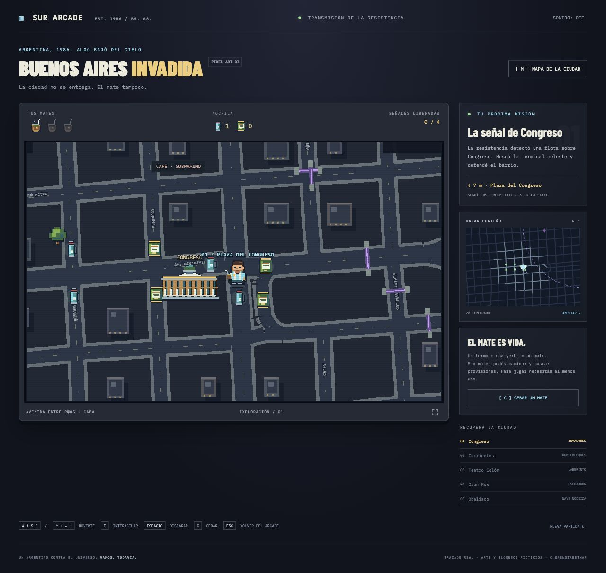
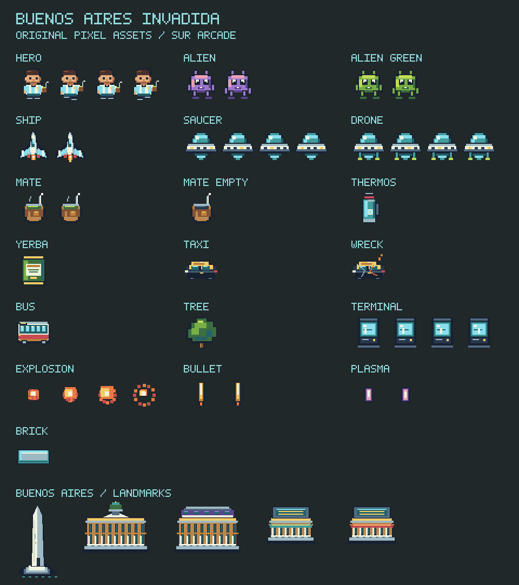

# Buenos Aires Invadida — Pixel Art 03

Aventura pixel art en Phaser 3.90.0. Abrir mediante un servidor HTTP (el JSON geográfico requiere HTTP):

```sh
git clone https://github.com/mescu74/pixelart-games-web.git
cd pixelart-games-web
python3 -m http.server 8765 --bind 127.0.0.1
```

Jugar en http://127.0.0.1:8765. No necesita instalar dependencias. Phaser está incluido en `vendor/`; las tipografías de Google son opcionales y tienen fuentes de respaldo.



## Campaña

1. Congreso: 18 invasores.
2. Teatro San Martín / Corrientes: 24 bloques.
3. Teatro Colón: laberinto con puntos, poderes y fantasmas.
4. Gran Rex: 20 naves con ataques en picada.
5. Obelisco: nave nodriza con 35 puntos de resistencia.

Cada victoria abre el siguiente cerco y devuelve un mate, hasta un máximo de tres. Un impacto cuesta un mate. Escapar de un arcade cuesta un mate. Las derrotas no reinician la campaña. Con cero mates se puede recorrer el mapa y recolectar provisiones: un termo más una yerba permiten cebar una vida. Hay provisiones renovables junto a las terminales y por las calles (25 segundos, solo durante la exploración).

Flechas/WASD: caminar; Espacio: correr en la ciudad o disparar/lanzar dentro del arcade; E: terminal; C: cebar; M: mapa; Esc: salir del arcade. Incluye controles táctiles. El sonido se activa a elección. La campaña se guarda en localStorage de este navegador bajo `ba-invadida-v2`. Nueva partida pide confirmación dentro de la interfaz y elimina solamente este guardado.

## Geografía y alcance

El mapa usa geometría real de OpenStreetMap en aproximadamente 3,1 km de radio del Obelisco (unas 30 cuadras por dirección; las cuadras reales no son todas iguales). El dato fuente es una captura de junio de 2018, no una representación actualizada de tránsito o cierres. Incluye 3.805 tramos fuente, convertidos en 8.589 aristas caminables. Se conserva la orientación y el trazado, incluyendo las diagonales.

Los edificios, monumentos, fachadas, cierres y lugares de las terminales son interpretaciones para el juego. No se replica cada fachada ni se usa un mapa de tránsito en vivo. La terminal del Colón se ubica en el acceso norte para mantener el recorrido y las barreras jugables. La campaña recorre aproximadamente 3 km de calles; se puede explorar una zona mucho mayor que el itinerario principal.

Fuente: [alephcero/bsas_urban_area_streets](https://github.com/alephcero/bsas_urban_area_streets), `callejero.zip`, extracción original de OSM mediante OSMnx. Datos © [OpenStreetMap contributors](https://www.openstreetmap.org/copyright), ODbL 1.0. `map-data.json` es una base derivada bajo ODbL 1.0. El importador reproducible está en `scripts/import-map.py` y no necesita librerías de Python adicionales. Phaser tiene licencia MIT: [Phaser 3.90.0](https://github.com/phaserjs/phaser/tree/v3.90.0). Los homenajes arcade usan dibujos y código propios.

## Verificación

```sh
node --check game.js
node --check core.js
node scripts/check.cjs
node scripts/check-assets.cjs
```

Las pruebas verifican las cinco rutas con obstáculos, los bloqueos de progresión, la economía de mates, guardados inválidos y nombres de avenidas. También se verificó movimiento por las cinco rutas en Phaser y los estados de derrota, recuperación y victoria dentro del navegador.

`scripts/browser-check.js` contiene un simulador para pruebas locales de puntuación y transiciones. Se carga manualmente en DevTools y se ejecuta `await runArcadeSmoke(indice)`, con índices 0 a 4. Cambia la partida de prueba: reiniciar al finalizar. El solucionador de laberinto conserva el poder y el de la nave nodriza conserva la invulnerabilidad, para aislar la conectividad del laberinto y las reglas de puntuación de la dificultad. El rompebloques y los dos escuadrones usan sus colisiones y controles normales. Estas pruebas no certifican dificultad, diversión ni una partida humana completa.

## Próximas iteraciones

Ajustar dificultad y legibilidad con una primera partida humana, ampliar animaciones y personalidad del protagonista, ilustrar más fachadas porteñas, sumar vecinos y diálogos, y reemplazar el snapshot geográfico por un dato más reciente si cambia el alcance. El MVP corre localmente, sin backend ni publicación externa.


## Assets originales — rama de prueba

Esta versión incorpora 24 sprites/sheets originales (47 fotogramas), fuente bitmap 5×7 y mates propios en el HUD. Incluye caminata del protagonista, naves y aliens animados, explosiones de seis fotogramas, proyectiles, terminales, provisiones, taxis, colectivos y cinco monumentos/teatros. Los sprites del laberinto y los bloques también usan el nuevo conjunto. El trazado, los objetivos, las colisiones y el guardado se mantienen compatibles con el MVP anterior.



El generador reproducible es `scripts/generate-assets.py`. Se necesita Pillow solo para regenerar los PNG, no para jugar. Ver [documentación de los assets](assets/README.md).

Prueba de esta rama:

```sh
git fetch origin
git switch feat/original-pixel-assets
python3 -m http.server 8765 --bind 127.0.0.1
```

La referencia visual enviada se usó para orientar el estilo de contornos, paleta y lectura arcade; no se incluyeron recortes, trazados ni imágenes de stock.
